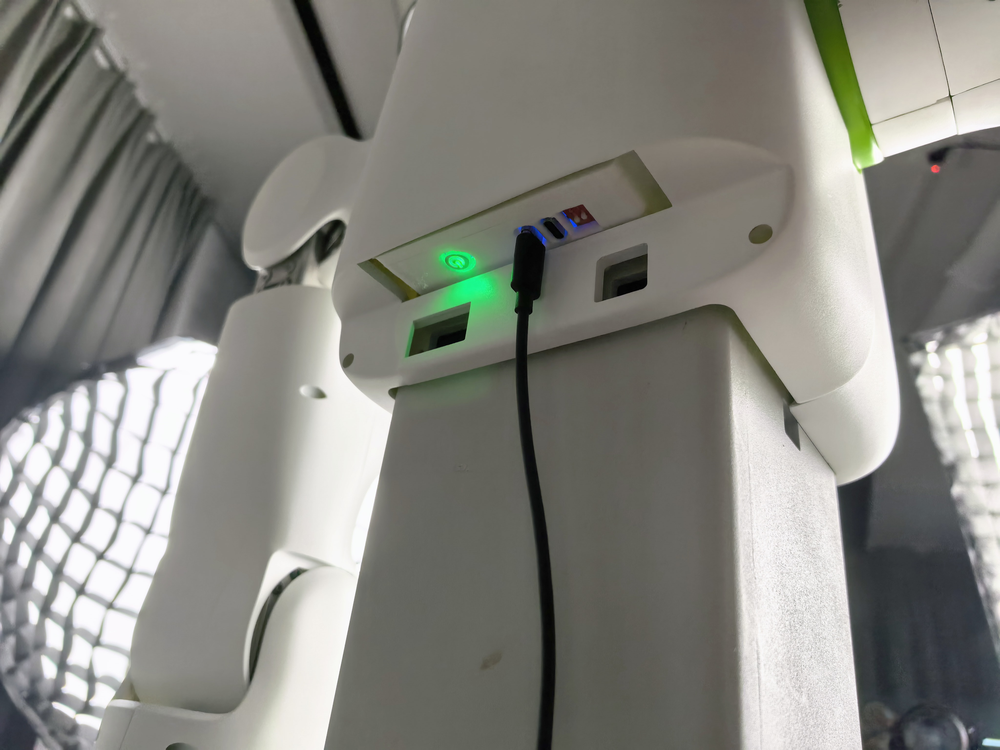

# T701-HT SDK

[简体中文](README_CN.md)

Ubuntu 22.04 (x86_64) and Python 3.10. Run the commands below from the SDK root.

## 1. Set up the environment

If you don't have Conda, install Miniforge.

```bash
wget "https://github.com/conda-forge/miniforge/releases/latest/download/Miniforge3-$(uname)-$(uname -m).sh"
bash Miniforge3-$(uname)-$(uname -m).sh
```

Follow the prompts to initialize Conda, then open a new terminal and return to the SDK root.

```bash
conda create -n t701-ht python=3.10 pip
conda activate t701-ht
python -I -m pip install ./motor_whl/hightorque_robot-1.2.0-cp310-cp310-linux_x86_64.whl
python -I -m pip install -r requirements.txt
```

Check the dependencies and URDF model with the arms disconnected.

```bash
python -I -c "import hightorque_robot, numpy, pinocchio, scipy, yaml; pinocchio.buildModelFromUrdf('T701-HT_URDF/urdf/T701-HT.urdf'); print('T701-HT environment check passed')"
```

## 2. Connect the arms

1. Connect the power supply.

   

2. Press the round power button.
3. Connect the computer to the mainboard's USB-C port with a USB data cable.

   

Use `--arm both` for both arms, or `--arm left` or `--arm right` for one arm.

```bash
ls -l /dev/ttyACM*
python scripts/t701_ht_read_state.py --arm both --check
```

The default ports are `/dev/ttyACM0` for the left arm and `/dev/ttyACM1` for the right arm. If the check reports a permission error, use the following command to grant all local users temporary read and write access, then run the check again. For one arm, specify only its port. Reconnecting or rebooting resets these permissions.

```bash
sudo chmod 666 /dev/ttyACM0 /dev/ttyACM1
```

## 3. Read motor state

In the menu, enter `1` for the left arm, `2` for the right arm, or `3` for both. Press `Ctrl+C` to exit.

```bash
python scripts/t701_ht_read_state.py
```

To read one sample and exit, run the following command.

```bash
python scripts/t701_ht_read_state.py --arm both --once
```

## 4. Set zero positions

Place the selected arm's joints and gripper at their zero positions. Run the script and enter `yes` to overwrite the stored zero positions. Replace `left` with `right` or `both` as needed.

```bash
python scripts/t701_ht_set_zero.py --arm left
```

## 5. Run the demos

Verify the joint zero positions, remove any payload, and clear the arms' range of motion. Start with one arm. Each script opens the same `1`/`2`/`3` menu and accepts `--arm left`, `--arm right`, or `--arm both`.

### Gravity compensation

The demo applies `0.8 × G(q)` as MIT torque feedforward to make the arm easier to move by hand. The joint `Kp` and `Kd` gains and the gripper torque are zero. Support the arm when starting and stopping the demo.

```bash
python scripts/t701_ht_gravity_compensation.py
```

### Joint impedance

The arm moves toward a fixed joint target. The left-arm target is `[-0.2, -0.2, 0.2, -0.4, 0.5, 0.2, -0.1]` rad. The right-arm target reverses the sign of each joint angle.

Joint impedance with gravity feedforward

```bash
python scripts/t701_ht_joint_impedance_with_gravity.py
```

Joint impedance with gravity feedforward and friction compensation

```bash
python scripts/t701_ht_joint_impedance_with_gravity_friction.py
```

All three demos display the commanded torque in N·m, apply the configured joint torque limits, and set a 250 ms motor command timeout. Press `Ctrl+C` to send stop commands to the selected arms and grippers. Stale feedback, a motor fault, or a joint outside its limits also triggers a stop. Support the arms when stopping.

See the [license](LICENSE).
