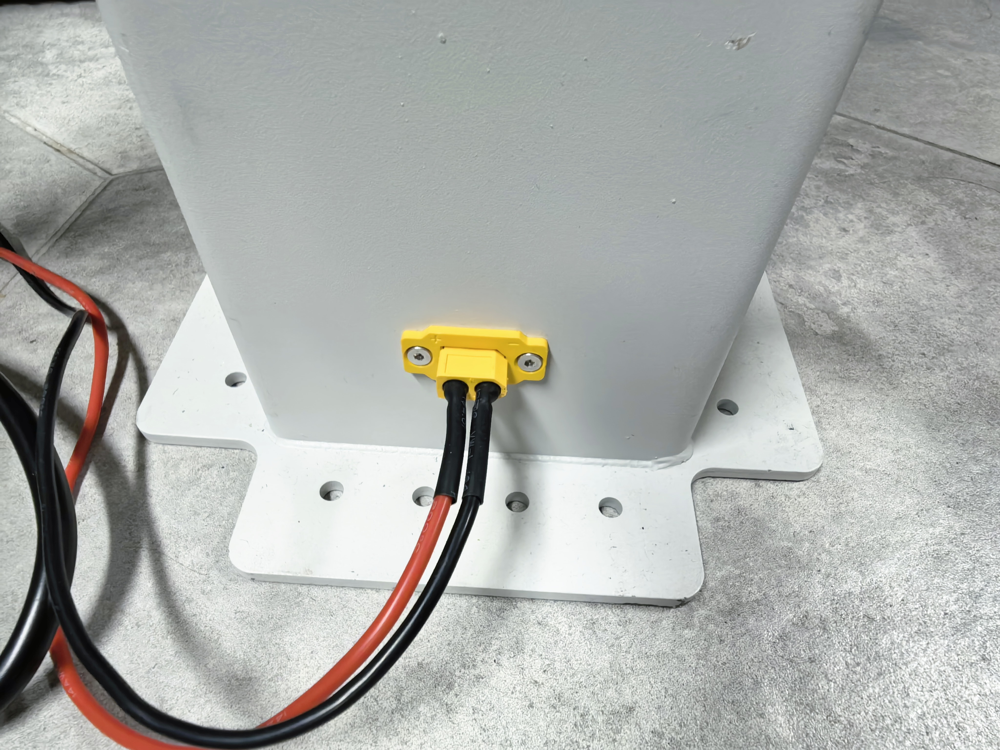

# T701-HT SDK

[简体中文](README_CN.md)

Ubuntu 22.04 (x86_64) and Python 3.10. Run the commands below from the SDK root.

## 1. Set up the environment

If you don't have Conda, install Miniforge.

```bash
wget "https://github.com/conda-forge/miniforge/releases/latest/download/Miniforge3-$(uname)-$(uname -m).sh"
bash Miniforge3-$(uname)-$(uname -m).sh
```

Follow the prompts to initialize Conda, then open a new terminal and return to the SDK root.

```bash
conda create -n t701-ht python=3.10 pip
conda activate t701-ht
python -I -m pip install ./motor_whl/hightorque_robot-1.2.0-cp310-cp310-linux_x86_64.whl
python -I -m pip install -r requirements.txt
```

Check the dependencies and URDF model. You can run this check with the arms disconnected.

```bash
python -I -c "import hightorque_robot, numpy, osqp, pinocchio, scipy, yaml; pinocchio.buildModelFromUrdf('T701-HT_URDF/urdf/T701-HT.urdf'); print('T701-HT environment check passed')"
```

## 2. Check the connections

1. Connect the power supply.

   

2. Press the round power button.
3. Connect the computer to the mainboard's USB-C port with a USB data cable.

   

The left arm uses CAN1 and the right arm uses CAN2. Set `board_serial` in the serial binding configuration to the communication board's USB serial number. At startup, the SDK uses the board's USB identity to locate the current serial port. [serial_binding.yaml](T701-HT_robot_param/serial_binding.yaml)

Check the mapping without opening the serial ports. Pass only the corresponding YAML file to check one arm.

```bash
ls -l /dev/serial/by-id/
python scripts/t701_ht_can_serial_adapter.py T701-HT_robot_param/T701-HT_left.yaml T701-HT_robot_param/T701-HT_right.yaml
```

If Ubuntu reports a serial port permission error, check that your user has read and write access to the device through the `dialout` group.

## 3. Read motor state

Enter `1` for the left arm, `2` for the right arm, or `3` for both. About twice a second, the script prints each joint's position, velocity, and torque, plus the gripper's position and velocity. Press `Ctrl+C` to exit.

```bash
python scripts/t701_ht_read_state.py
```

## 4. Set zero positions


After choosing an arm, select `1` to read its state once or `2` to read it continuously. With its joints and gripper at their intended zero positions, select `3` to save the current pose as zero. Select `4` to drive the arm to its stored zero position or `0` to exit.

```bash
python scripts/t701_ht_set_zero.py
```

## 5. Run the demos

Verify the joint zero positions, remove any payload, and clear the arms' range of motion. Start with one arm. Run the demos from the `scripts` directory and enter `1`, `2`, or `3` to select the left arm, right arm, or both.

```bash
cd scripts
```

### Gravity compensation

The demo applies `0.8 × G(q)` as MIT torque feedforward to make the arm easier to move by hand. The joint `Kp` and `Kd` gains and the gripper torque are zero. Support the arm when starting and stopping the demo.

```bash
python t701_ht_gravity_compensation.py
```

### Joint impedance

> **Before starting either demo, make sure the area around the robot and within the arms' range of motion is clear of people and fragile objects.**

The arm moves toward a fixed joint pose at startup. The left-arm target is approximately `[-0.2, -0.2, 0.2, -0.4, 0.5, 0.2, 1.4708]` rad. For the right arm, each target angle has the opposite sign.

Joint impedance with gravity feedforward

```bash
python t701_ht_joint_impedance_with_gravity.py
```

Joint impedance with gravity feedforward and friction compensation

```bash
python t701_ht_joint_impedance_with_gravity_friction.py
```

All three demos apply the configured joint torque limits. Press `Ctrl+C` to stop the gravity compensation demo. In the joint impedance demos, `Ctrl+C` returns the arms to zero and then stops them. Press `Ctrl+C` again during the return to stop the arms.

For more examples, see [T701-HT and Pinocchio](README_Pinocchio.md).

See the [license](LICENSE).
