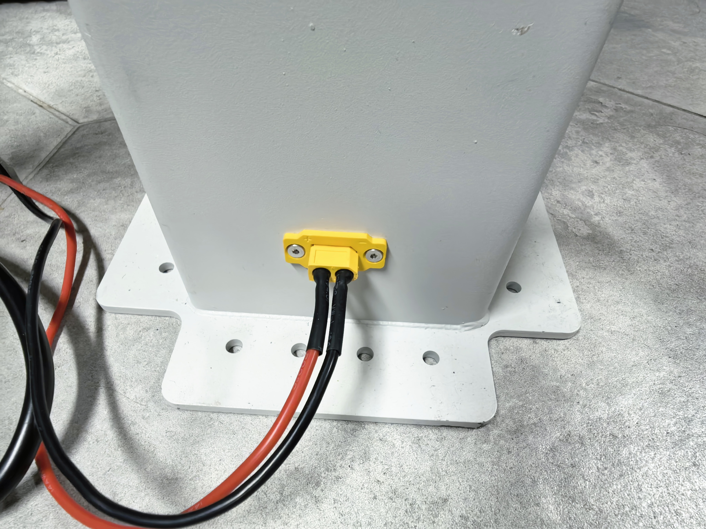
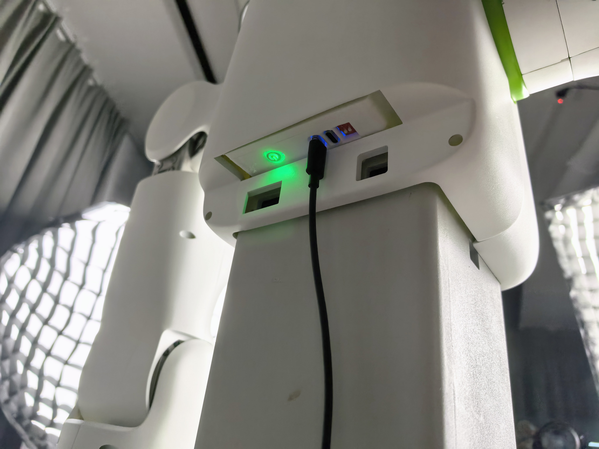
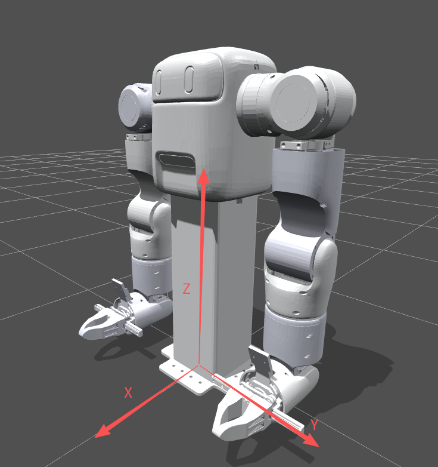

# T701-HT SDK

[English](README.md)

Ubuntu 22.04（x86_64），Python 3.10。以下命令在项目根目录运行。

## 1. 安装环境

未安装 Conda 时，先安装 Miniforge。

```bash
wget "https://github.com/conda-forge/miniforge/releases/latest/download/Miniforge3-$(uname)-$(uname -m).sh"
bash Miniforge3-$(uname)-$(uname -m).sh
```

按提示初始化 Conda，重新打开终端并回到项目根目录。

```bash
conda create -n t701-ht python=3.10 pip
conda activate t701-ht
python -I -m pip install ./motor_whl/hightorque_robot-1.2.0-cp310-cp310-linux_x86_64.whl
python -I -m pip install -r requirements.txt
```

验证依赖和 URDF 模型（无需连接机械臂）。

```bash
python -I -c "import hightorque_robot, numpy, osqp, pinocchio, scipy, yaml; pinocchio.buildModelFromUrdf('T701-HT_URDF/urdf/T701-HT.urdf'); print('T701-HT 环境检查通过')"
```

## 2. 检查连接

1. 接上电源。

   

2. 按下圆形开关开机。
3. 用 USB 数据线连接电脑和主板的 Type-C 接口。

   

左臂接 CAN1，右臂接 CAN2。将 [serial_binding.yaml](T701-HT_robot_param/serial_binding.yaml) 里的 `board_serial` 填为通信板的 USB 序列号。SDK 启动时按 USB 身份查找当前串口。

以下命令只检查映射，不打开串口。检查单臂时只传对应的 YAML 文件。

```bash
ls -l /dev/serial/by-id/
python scripts/t701_ht_can_serial_adapter.py T701-HT_robot_param/T701-HT_left.yaml T701-HT_robot_param/T701-HT_right.yaml
```

在 Ubuntu 上，若提示串口权限不足，请检查当前用户是否通过 `dialout` 组获得该设备的读写权限。

## 3. 读取状态

输入 `1`、`2` 或 `3` 选择左臂、右臂或双臂。约每半秒打印各关节的位置、速度和力矩，以及夹爪的位置和速度。按 `Ctrl+C` 退出。

```bash
python scripts/t701_ht_read_state.py
```

## 4. 设置零点



选择机械臂后，操作菜单的 `1` 和 `2` 分别读取一次和连续读取状态。摆好关节和夹爪后，选 `3` 将当前姿态设为零位，选 `4` 驱动机械臂回到已保存的零位，选 `0` 退出。

```bash
python scripts/t701_ht_set_zero.py
```

## 5. 运行示例

确认关节零点，取下负载并清空机械臂的活动范围。首次运行时选单臂。先进入 `scripts` 目录，运行后输入 `1`、`2` 或 `3` 选择左臂、右臂或双臂。

```bash
cd scripts
```

### 重力补偿

示例以 MIT 力矩前馈施加 `0.8 × G(q)`，减轻手动移动机械臂时的负担。关节 `Kp`、`Kd` 和夹爪力矩均为零。启动和退出时托住机械臂。

```bash
python t701_ht_gravity_compensation.py
```

示例按配置限制关节力矩。按 `Ctrl+C` 退出时停止电机。更多例程见 [T701-HT 与 Pinocchio](README_Pinocchio_CN.md)。

## 6. VR 遥操作

按 [VR 启动说明](README_VR_CN.md) 配置 USB 或 WiFi 串流，再运行 `scripts/t701_ht_vr_dual_cartesian_qp_control.py`。该入口直接控制双臂；启动前停止 Verify，清空机械臂活动范围。

许可见 [LICENSE](LICENSE)。
